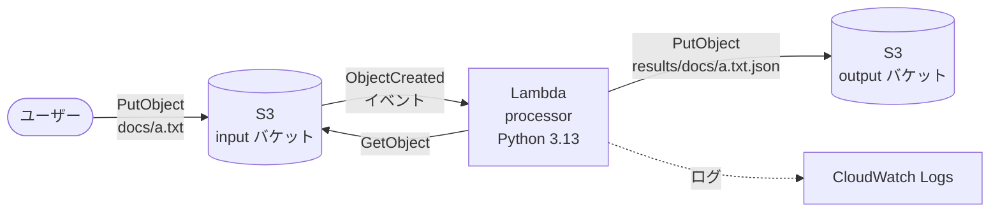

# aws-emulator-terraform-ci-example

[AWS Emulator](https://github.com/aws/aws-emulator) を使い、**AWS アカウントも認証情報も使わずに** GitHub Actions 上で Terraform の `plan` / `apply` を実行するサンプルリポジトリです。

- AWS Emulator ユーザーガイド: <https://docs.aws.amazon.com/ja_jp/emulator/latest/userguide/what-is-service.html>
- ローカルでの動作確認: AWS Emulator 1.0.322 / Terraform 1.16.5 / hashicorp/aws 6.73.0 / hashicorp/archive 2.8.1（CI は Terraform 1.17.2 を使用）

## サンプルの構成

S3 にテキストファイルをアップロードすると Lambda が起動し、行数・単語数・文字数を集計して結果を JSON で別のバケットに書き出します。リージョンは東京（`ap-northeast-1`）です。



入力と出力のバケットを分けているのは、Lambda の出力で Lambda 自身が再び起動されるループを防ぐためです。

## CI の流れ

[.github/workflows/terraform-ci.yml](.github/workflows/terraform-ci.yml) は 1 つのジョブで、次の順に実行します。

1. `terraform fmt -check`
2. AWS Emulator をコンテナで起動（[run-aws-emulator](https://github.com/marketplace/actions/run-aws-emulator) アクション）
3. `terraform init` / `terraform validate`
4. `terraform plan`
5. `terraform apply`

エミュレーターはジョブの終了とともに止まり、作ったリソースもすべて消えます。そのため destroy は不要です。

## ディレクトリ構成

```text
.
├── .github/
│   └── workflows/terraform-ci.yml             # CI 本体
├── emulator/
│   └── aws_provider_override.tf               # エミュレーター実行時だけ terraform/ にコピーする override
├── lambda/
│   └── processor/handler.py                   # Lambda のコード
├── scripts/
│   └── emulator-env.sh                        # ローカル用: エミュレーターに向ける環境変数を設定
├── terraform/                                 # 本番と共通の Terraform コード（エミュレーター固有の設定は書かない）
└── Makefile                                   # ローカルで CI と同じ流れを実行
```

## 仕組み

### 1. エミュレーターの起動（run-aws-emulator アクション）

[xSAVIKx/run-aws-emulator](https://github.com/xSAVIKx/run-aws-emulator) は、AWS Emulator を入れたコンテナイメージ（`ghcr.io/xsavikx/aws-emulator`）を起動するアクションです。起動後は `/__admin/health` が `ok` を返すまで待ち、接続用の環境変数を以降のステップに渡します。

非公式のコミュニティ製アクションです。そのため、ワークフローではタグではなくコミット SHA（`v1.0.1`）で固定しています。

エミュレーターは起動のたびにアクセスキー・設定ファイル・自己署名証明書を `~/.aws/emulator/<port>/` に生成します。アクションはそれを指す環境変数を設定するので、AWS CLI / Terraform の接続先が切り替わります。主な環境変数は次のとおりです。

```bash
AWS_ENDPOINT_URL=https://127.0.0.1:9297          # localhost ではなく 127.0.0.1（S3 がパススタイルになる）
AWS_SHARED_CREDENTIALS_FILE=~/.aws/emulator/9297/emulator_credentials
AWS_CONFIG_FILE=~/.aws/emulator/9297/config
AWS_CA_BUNDLE=~/.aws/emulator/9297/ca.pem
AWS_EC2_METADATA_DISABLED=true
AWS_DISABLE_HOST_PREFIX_INJECTION=true
AWS_REGION=ap-northeast-1
AWS_DEFAULT_REGION=ap-northeast-1
```

### 2. Terraform 側はエミュレーター固有の設定を持たない

`terraform/providers.tf` には `endpoints` や `skip_*` を一切書いていません。本番 AWS とエミュレーターで同じコードを使います。

どうしても必要な差分（後述）だけを `emulator/aws_provider_override.tf` に切り出し、CI（と `make`）でのみ `terraform/` にコピーします。Terraform は `*_override.tf` を通常の設定にマージする（[Override Files](https://developer.hashicorp.com/terraform/language/files/override)）ので、本番用のファイルには手を入れずに済みます。`terraform/*_override.tf` は `.gitignore` 済みです。

## 注意点

### S3 バケットのタグ操作が失敗する（override で回避）

```text
Error: listing tags for S3 (Simple Storage) Bucket (...): operation error S3 Control: ListTagsForResource,
... dial tcp: lookup 000000000000.127.0.0.1: no such host
```

AWS provider v6 はアカウント ID が分かっていると、S3 バケットのタグ操作に S3 Control API を使います。S3 Control のリクエストはホスト名にアカウント ID が付く（`000000000000.127.0.0.1`）ため、エミュレーターには届きません（[ユーザーガイドにも記載のある制約](https://docs.aws.amazon.com/emulator/latest/userguide/point-sdk-to-emulator.html#point-sdk-host-names)）。

プロバイダーはアカウント ID が無いときは従来の `GetBucketTagging` / `PutBucketTagging` を使うので、override で次の 2 つを設定して回避しています（`skip_requesting_account_id` だけでは、クレデンシャル検証の結果からアカウント ID が取られてしまうため不十分です）。

```hcl
provider "aws" {
  skip_credentials_validation = true
  skip_requesting_account_id  = true
}
```

アカウント ID が必要な箇所は `data "aws_caller_identity"` で引き続き取得できます。

### その他

- **IAM ポリシーは評価されません。** 権限不足のテストやセキュリティの検証には使えません。
- **1 プロセス = 1 リージョン・1 アカウント**です。複数リージョンを使う構成では、リージョンごとにポートを変えてエミュレーターを起動する必要があります。
- **再現度（フィデリティ）はサービスや API で異なります。** 未実装の操作は HTTP 501 `NotImplemented` を返します。各リリースのサービスごとのスコアは [Releases](https://github.com/aws/aws-emulator/releases) で確認できます。
- エミュレーターは 1 日に何度もリリースされます。急に CI が落ちるのを避けたい場合は、ワークフローの `AWS_EMULATOR_IMAGE` を `ghcr.io/xsavikx/aws-emulator:1.0.322` のようにタグで固定してください。
- リモートバックエンド（`backend "s3"` など）を使っている場合は、override に `terraform { backend "local" {} }` を追加すると、CI ではローカル state を使えます。

## ローカルで実行する

### 1. エミュレーターを起動する

Linux ではパッケージをインストールして起動します。macOS / Windows では [Docker で起動](https://docs.aws.amazon.com/emulator/latest/userguide/getting-started-docker.html)してください。

```bash
# Debian / Ubuntu (amd64)
curl -fsSLo aws-emulator.deb https://downloads.aws.com/aws-emulator/packages/aws-emulator/LTS/latest/aws-emulator_amd64.deb
sudo apt-get install -y ./aws-emulator.deb

aws-emulator --telemetry off   # フォアグラウンドで起動。Ctrl+C で停止（リソースはすべて消える）
```

### 2. 別のターミナルで CI と同じ流れを実行する

```bash
source scripts/emulator-env.sh   # AWS CLI / Terraform をエミュレーターに向ける

make lint    # fmt チェック + validate
make apply   # plan -> apply
make clean   # .terraform/ や state、コピーした override、Lambda の zip を削除
```

`make plan` / `make apply` は最初に `aws sts get-caller-identity` でアカウントが `000000000000` であることを確認します。そのため、`emulator-env.sh` を読み込み忘れて本物の AWS に apply してしまうことはありません。

エミュレーターを再起動するとリソースは消えますが、ローカルの state は残ります。再起動した後は `make clean` してから apply し直してください。

apply した後は、実際にファイルを置いて Lambda の動作を試せます。

```bash
echo "hello world" | aws s3 cp - "s3://$(terraform -chdir=terraform output -raw input_bucket)/docs/a.txt"
aws s3 cp "s3://$(terraform -chdir=terraform output -raw output_bucket)/results/docs/a.txt.json" -
```
